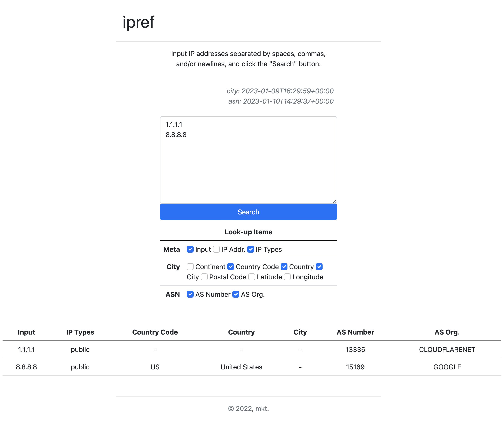

# ipref


`ipref-py` is a simple utility to look up IP addresses in MaxMind's
downloadable GeoIP databases, from the command line or from a web browser.

I often need to look up geolocation data for large numbers of IP addresses in
my research, but the existing tools did not fit that workflow well.
So I wrote `ipref-py`.

Note that the web interface is intended for internal use only, such as on your
own machine or within your lab. If you expose it publicly, it can be abused by
attackers and may also violate MaxMind's terms of use.

Main features:

- Look up IP addresses in MaxMind's GeoIP databases.
- Resolve hostnames of IP addresses by reverse DNS lookups.
- A command-line tool and a simple web interface.
- Configuration via YAML files.
- Flexible output formats (JSON, JSON-Lines, CSV, TSV).


## Requirements

- Python 3.9 or later
- Linux or macOS (It may work on Windows, but this has not been tested.)


## Installation

(Optional, but recommended) Create a Python virtual environment.

```sh
# /path/to/dir/ depends on your environment. e.g. /opt/ipref/
$ cd /path/to/dir/

# Create a virtual environment
$ python3 -m venv env

# Activate the virtual environment
$ source env/bin/activate
```

You can install `ipref-py` from PyPI. Wheel files are also available from the
[GitHub releases](https://github.com/md-irohas/ipref-py/releases) page.

```sh
# CLI only
(env) $ pip install ipref

# CLI and web interface
(env) $ pip install ipref[web]
```


## Configuration

Create a configuration file.
The following configuration templates are available:

- GeoIP2: https://github.com/md-irohas/ipref-py/blob/main/ipref/config.yaml.orig
- GeoLite: https://github.com/md-irohas/ipref-py/blob/main/ipref/config-geolite.yaml.orig

Configuration files are loaded from the following paths:

- `~/.config/ipref.yaml`
- `~/.config/ipref.yml`
- `~/.ipref.yaml`
- `~/.ipref.yml`
- (environment variable `IPREF_CONF`)
- (command line argument [CLI only])

Settings from files listed later override those from earlier ones.

```sh
# Copy one of the configuration templates above and edit it.
$ vim ~/.config/ipref.yaml
...(edit)...
```


## CLI Examples

### Usage

```sh
$ ipref --help

usage: ipref [-h] [-v] [-d] [-c CONFIG] [-I {ip,file}]
             [-O {tsv,json,jsonl,csv}] [--csv-columns CSV_COLUMNS]
             [--csv-exclude-header] [--csv-escape-comma]
             [items ...]

positional arguments:
  items                 IP addresses or filenames. if input_type is file and
                        the items are empty, stdin is used. (default: None)

options:
  -h, --help            show this help message and exit
  -v, --version         show version and exit.
  -d, --debug           enable debug logging to stderr. (default: False)
  -c CONFIG, --config CONFIG
                        path to config file. (default: None)
  -I {ip,file}, --input-type {ip,file}
                        input type. (default: ip)
  -O {tsv,json,jsonl,csv}, --output-format {tsv,json,jsonl,csv}
                        output format. (default: json)
  --csv-columns CSV_COLUMNS
                        [csv|tsv] output columns separated by comma (,).
                        (default: None)
  --csv-exclude-header  [csv|tsv] exclude a csv header. (default: False)
  --csv-escape-comma    [csv|tsv] replace commas (,) to <comma> (useful when
                        using commands such as 'cut'). (default: False)
```


### Example-1: First steps

The following example looks up "1.1.1.1" and "8.8.8.8" from the command line and prints the results in CSV format.

```sh
$ ipref -O csv "1.1.1.1" "8.8.8.8"
meta.raw_input,meta.ip_address_types,geoip.city.continent.names.en,geoip.city.country.iso_code,geoip.city.country.names.en,geoip.city.city.names.en,geoip.city.postal.code,geoip.city.location.latitude,geoip.city.location.longitude,geoip.asn.autonomous_system_number,geoip.asn.autonomous_system_organization
1.1.1.1,public,,,,,,,,13335,CLOUDFLARENET
8.8.8.8,public,North America,US,United States,,,37.751,-97.822,15169,GOOGLE
```


### Example-2: Flexible output

You can specify which columns are printed in the CSV/TSV formats.
See the `output.columns` section in `config.yaml.orig` for the list of column names.

```sh
$ ipref -O csv --csv-columns meta.raw_input,geoip.city.country.name "1.1.1.1" "8.8.8.8"
meta.raw_input,geoip.city.country.name
1.1.1.1,
8.8.8.8,United States
```

You can also set the columns in the configuration file.


### Example-3: Bulk search

To look up many IP addresses at once, you can pass them via files.

```sh
# from stdin
$ cat ip-list.txt | ipref -O csv

# from files
$ ipref -I file -O csv file1.txt file2.txt ...
```


## Web Examples

A simple web app is also available.




### Example-4: Launch a web app

Launch ipref-web from the command line and open http://localhost:5000/.
You will see a simple web interface like the one in the figure above.

```sh
$ IPREF_CONF="path/to/config.yaml" ipref-web run
```

Enter IP addresses, select the checkboxes you need, and click the "Search" button.
The "Look-up Items" are also configurable in config.yaml.


### Example-5: Run as a production WSGI app

Use gunicorn to run ipref-web as a production WSGI app.

```sh
$ gunicorn --env IPREF_CONF="path/to/config.yaml" "ipref.web:create_app()"
```

Template files for systemd (as a unit) and nginx (as a reverse proxy) are also available:

- systemd unit file: [etc/ipref-web.service](etc/ipref-web.service)
- nginx configuration file: [etc/nginx.conf](etc/nginx.conf)


### Example-6: API search with cURL

You can retrieve geolocation data for IP addresses with the `curl` command (since v0.3.0).
For now, the only output format is CSV (comma-separated values).

```sh
$ curl -X POST -F columns=meta.raw_input,meta.ip_address_types -F data=@path/to/ip-list.txt http://127.0.0.1:5000/api/v1/search?csv_noheader=1\&csv_nocomma=1
```

- `columns`: List of column names separated by commas (,).
  See the `output.columns` values in [ipref/config.yaml.orig](ipref/config.yaml.orig) for the available column names.
  If omitted, the items whose `checked` values are true in `web.search` are used by default.
- `data`: Path to a file containing a list of IP addresses separated by newlines (\n).
- `csv_noheader`: If set to 1, the CSV header is not printed (default: 0).
- `csv_nocomma`: If set to 1, commas in the output are replaced by '\<comma\>' (default: 0).
  This is useful when you pass the results to commands such as `cut`.


## Alternatives

- mmdbinspect: https://github.com/maxmind/mmdbinspect (MaxMind's official command-line lookup tool)
- geoiplookup command


## Contributing

See [CONTRIBUTING.md](CONTRIBUTING.md) for how to contribute (bug reports,
feature requests, and pull requests), and [README-dev.md](README-dev.md) for
the development guide.


## License

MIT License (see [LICENSE](LICENSE)).


## Contact

mkt (E-mail: md.irohas at gmail.com)

